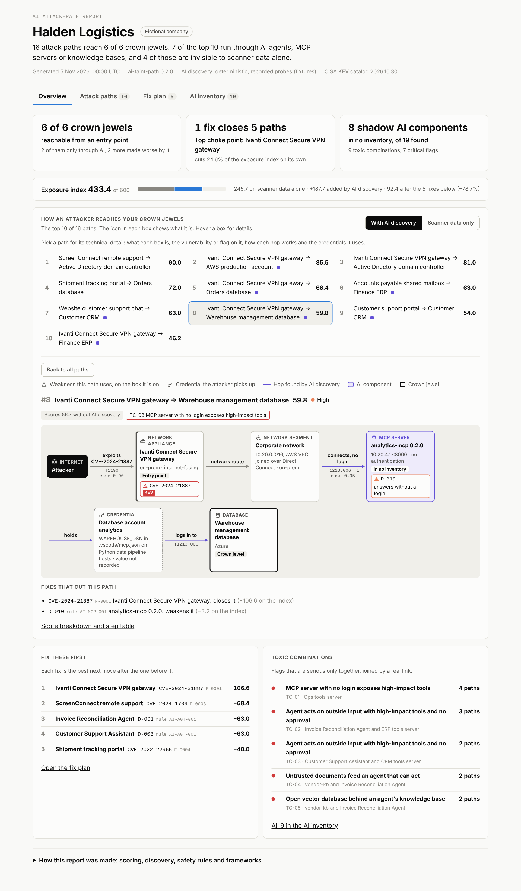

# ai-taint-path

Follows untrusted input (a chat message, an emailed invoice, a poisoned document) through shadow AI agents, MCP servers, knowledge bases and identities to the systems that matter.

**[Live demo with a guided tour](https://yaronimac.github.io/ai-taint-path/demo.html#tour)** · [About the project](https://yaronimac.github.io/ai-taint-path/) · [PRD and GTM brief](https://yaronimac.github.io/ai-taint-path/brief.html)

**Status: week 2 of 3.** The discovery agent, the prioritization engine, JSON output with a published schema and an HTML dashboard are done. The analyst agent and the rest of the SOAR integration (REST API, signed webhooks, example playbook) are next.

Security teams can see thousands of exposures but can't tell which few actually lead to their critical assets. AI agents make this worse: they add tools, identities and MCP servers that most exposure tools don't model as attack surface, and many of them are in no inventory at all.

ai-taint-path does two things. A **discovery agent** finds the AI agents, MCP servers, RAG knowledge bases and vector databases in use, from MCP client configs, read-only probes and cloud AI platform exports, and flags their risks. A **prioritization engine** then joins them with scanner, CMDB and identity data and ranks the **attack paths to crown-jewel assets**, with an explainable score, the fixes that cut the most risk, and the frameworks each step maps to.

## What it finds in the sample company

Halden Logistics is a fictional 4,500-person freight company with planted problems (see [Sample data](#sample-data-and-ground-truth)). On scanner, CMDB and posture data alone, the engine scores its exposure at 245.7 of 600. With AI discovery it is **433.4**: the AI layer opens paths that a scanner-only view cannot see.

- **7 of the top 10 attack paths run through AI components.** 4 of them are invisible without discovery, and 3 more score far lower without it.
- **19 AI components found, 8 of them in no inventory**, with 25 risk flags (7 critical): MCP servers that answer without a login, a tool description with hidden instructions, a poisoned support-ticket attachment in a knowledge base, an open vector database, agents that act on public or emailed input with no human approval.
- **5 fixes cut the exposure index by 78.7%.** The first is an Ivanti VPN flaw that ranks only #11 on a CVSS-sorted list, and 2 of the 5 are AI agent approval settings that no vulnerability scanner reports.
- **9 toxic combinations**, where flags join up into one attack: emailed invoices reach an agent that can change vendor bank details with nobody approving, a poisoned support-ticket attachment feeds the support assistant, an open Qdrant database holds the vectors behind the finance agent's knowledge base.
- **8 of the 10 highest-CVSS findings lead to no crown jewel at all.**

| # | Score | Path | Through AI | Without discovery |
| --- | --- | --- | --- | --- |
| 1 | 90.0 | ScreenConnect remote support → Active Directory domain controller | - | 90.0 |
| 2 | 85.5 | Ivanti Connect Secure VPN → AWS production account | Ops tools MCP server (no login) | 27.0 |
| 3 | 81.0 | Ivanti Connect Secure VPN → Active Directory domain controller | - | 81.0 |
| 4 | 72.0 | Shipment tracking portal → Orders database | - | 72.0 |
| 5 | 68.4 | Ivanti Connect Secure VPN → Orders database | Ops tools MCP server (no login) | 21.6 |
| 6 | 63.0 | Accounts payable mailbox → Finance ERP | Invoice Reconciliation Agent, ERP tools server | not found |
| 7 | 63.0 | Website support chat → Customer CRM | Customer Support Assistant, CRM tools server | not found |
| 8 | 59.8 | Ivanti Connect Secure VPN → Warehouse management database | analytics-mcp (shadow, no login) | 56.7 |
| 9 | 54.0 | Customer support portal → Customer CRM | support-kb (poisoned attachment), Customer Support Assistant, CRM tools server | not found |
| 10 | 46.2 | Ivanti Connect Secure VPN → Finance ERP | unregistered Qdrant database, vendor-kb, Invoice Reconciliation Agent, ERP tools server | not found |

Open [`examples/halden-dashboard.html`](examples/halden-dashboard.html) in a browser for the full report, or [`examples/halden-scan.json`](examples/halden-scan.json) for the same data as JSON.

### The dashboard



One self-contained HTML file with four views, laid out the way AI security and exposure-management consoles present the same data:

- **Overview** answers three questions first: how many crown jewels are reachable (6 of 6, 2 only through AI), which single fix matters most (one VPN patch closes 5 paths), and how much AI is in no inventory (8 shadow components). Below them, an **attack-path graph** runs from entry points to crown jewels, with an icon in each box for what it is (gateway, server, identity, MCP server, database). Pick a path to open it in **technical detail**: every box with its type and facts, the CVE (with its KEV mark) or discovery flag pinned to the box it is on, a label on every hop saying how it works with its ATT&CK or ATLAS technique, service accounts with their permissions, and each credential the attacker picks up as its own box. Switch to **Scanner data only** to see the route a scanner shows instead, or that it shows none.
- **Attack paths** lists all 16 paths with filters (through AI, missed without discovery, critical, in a toxic combination). Each opens to the same technical diagram and a "why this rank" breakdown of its score.
- **Fix plan** is one queue with three orders: the re-scored plan, the biggest single fixes, and what a CVSS-sorted scanner list would do instead.
- **AI inventory** is the AI bill of materials: each agent's inputs, tools, identity and data, its owner, shadow status and flags, and the **toxic combinations** they form.

How the report was made (scoring, discovery log, safety rules, frameworks) sits in a collapsed panel at the bottom. Every finding shows its own ID (`D-001`, `F-0001`) next to its rule or CVE.

### The guided tour

`--tour` adds a guided tour to the dashboard, for demos. It dims the page, puts a ring around one thing at a time (a number, a button, a path) and explains it in a pop-up: the headline numbers, one attack path hop by hop, the same path through a scanner's eyes, the fix plan and the AI inventory. Some steps ask the reader to click the ringed button, and Next makes the same click for them. The steps are written from the report's own numbers, so the tour reads correctly for any scan. A link ending in `#tour` starts it on load, and `--tour-home URL` adds a link back to a project page.

## Quick start

Python 3.10 or later. No runtime dependencies.

```bash
git clone https://github.com/yaronimac/ai-taint-path && cd ai-taint-path
pip install -e '.[dev]'

ai-taint-path scan data/sample/halden                                   # ranked paths in the terminal
ai-taint-path scan data/sample/halden --format html --out report.html   # the dashboard
ai-taint-path scan data/sample/halden --format html --tour --out demo.html   # the dashboard with a guided tour
ai-taint-path scan data/sample/halden --format json --out scan.json     # for SOAR and ticketing
ai-taint-path scan data/sample/halden --no-discovery                    # the scanner-only baseline
ai-taint-path discover data/sample/halden                               # AI inventory and flags only
pytest -q                                                               # grade it against the ground truth
```

Without installing, use `python -m ai_taint_path` in place of `ai-taint-path`. By default discovery replays the recorded probe answers in `data/sample/halden/discovery/probes.json`; `--live` sends the same read-only probes over the network, inside `discovery/scope.json`.

## How it works

1. **Discovery** reads MCP client configs collected from hosts (Claude Desktop, Claude Code, Cursor, VS Code) and exports from cloud AI platforms (Azure AI Foundry, Amazon Bedrock). It turns them into leads, probes the leads that are in scope, and correlates everything into one AI inventory with graph edges: who can talk to which agent, which tools an agent can call without approval, what a server can touch. 15 rules flag the risks, each mapped to the [OWASP Top 10 for Agentic Applications](https://genai.owasp.org/2025/12/09/owasp-top-10-for-agentic-applications-the-benchmark-for-agentic-security-in-the-age-of-autonomous-ai/), the [OWASP Top 10 for LLM Applications](https://genai.owasp.org/llm-top-10/), [MITRE ATLAS](https://atlas.mitre.org/) and [MITRE ATT&CK](https://attack.mitre.org/).
2. **Enrichment** scores each CVE by how likely it is to be used: on the [CISA KEV](https://www.cisa.gov/known-exploited-vulnerabilities-catalog) list first, then [EPSS](https://www.first.org/epss/), then CVSS. Denial-of-service flaws and local-only flaws that are not known to be exploited are not footholds.
3. **The engine** builds one graph of assets, identities, AI components and network segments, and finds the most likely path from every entry point to every crown jewel.
4. **Choke points and the plan.** Every finding that gates a path is "fixed" in turn and the paths re-scored, to measure what each fix is worth. The remediation plan then picks the best next fix five times, re-scoring after each, because fixes overlap.
5. **Toxic combinations.** Discovery flags that are joined by a real link (this input reaches that agent, that agent reads this knowledge base or calls that server) are named as one risk, with the paths it sits on and the one fix that breaks it. Five patterns: outside input steering an agent with unapproved high-impact tools, untrusted documents feeding an agent that can act, an open vector database behind an agent's knowledge base, a poisoned tool description reaching such an agent, and an MCP server with no login that exposes high-impact tools.

**How a path is scored.** Score = 100 × exposure × likelihood × impact. Exposure is 1.0 when the entry point faces the internet and 0.6 when someone has to open or click something. Likelihood multiplies the ease of every step, for example 0.9 for a CVE on the KEV list or 0.95 for an MCP server that answers without a login. Impact is how much the crown jewel matters, from 0 to 1. Paths of 60 or more are critical, 40 high and 20 medium. Every step in the output says why it works, which findings it uses and which techniques it maps to.

**The exposure index** adds up the worst path score to each crown jewel, so it goes down only when a fix actually cuts a path.

## Safety

Discovery points at production networks and reads text written by systems that may already be compromised, so the rules below are enforced in code and covered by tests:

- **Read-only.** MCP servers are only asked to describe themselves (`initialize`, `notifications/initialized`, `tools/list`); `tools/call` is never sent. Vector databases are only asked to list their collections (Qdrant `GET /collections`, Weaviate `GET /v1/schema`). Redirects are not followed.
- **Scoped.** Every request is checked against the networks and hosts in `scope.json` and a request budget. Endpoints outside the scope list are recorded as leads but never contacted.
- **No secrets kept.** When a config file holds a secret, only the variable name is recorded as evidence.
- **Untrusted text stays inert.** Tool descriptions and documents are never followed as instructions, are cut to short excerpts in the evidence, and are HTML-escaped in the dashboard.

## Claude mode (optional)

By default discovery probes every lead in order. With `--agent claude`, a Claude agent reads the same leads, decides which to probe first, and writes a short note for the report. It runs inside the same fence and sees less than the crawler does:

- It picks leads by ID from the list the crawler built from the organization's own records, so it cannot name a target of its own.
- Its probes go through the same scope, allowlist and request budget.
- It never sees tool descriptions, server instructions or document text. Probes come back as structured fields plus a `hidden_instructions` flag, so a poisoned server has nothing to say to it.
- Its note goes into the report as text; the inventory, flags and paths are still computed by the same code.

```bash
pip install -e '.[ai]'
export ANTHROPIC_API_KEY=...     # or sign in once with `ant auth login`
ai-taint-path scan data/sample/halden --agent claude
```

The default model is `claude-opus-5-5`; use `--model` or `AI_TAINT_PATH_MODEL` to change it. Requests opt in to server-side fallbacks, so a request the model declines is retried on a fallback model. The tests drive the agent with a scripted client, with no network or API key.

## Integrate with SOAR and ticketing

`--format json` writes one document that follows [`schema/scan-result.schema.json`](schema/scan-result.schema.json) (JSON Schema 2020-12, schema version 1.1). The tests validate every output against it.

- Path IDs (`entry->target`) and finding IDs (`F-0001` from scanners, `D-001` from discovery) are stable across runs on the same data, so a playbook can track them over time.
- `paths[]` has the score, tier, `top`, `through_ai` and `blind_spot` flags, and every step with its reason, findings and techniques. A step that uses a stored credential names it in `credential` (the account, the config variable and file that hold it, never the value).
- `nodes[]` says what each box is (`type`), where it runs (`env`) and, for an identity, who uses it, its `permissions` and whether it has MFA. `baseline.paths[]` gives the scanner-only route for the same entry and target, step by step.
- `remediation_plan[]` and `choke_points[]` give the fixes in order, with how much of the exposure index each one removes, ready to become tickets.
- `findings[]` carries each finding's frameworks, evidence and the paths it sits on.
- `toxic_combinations[]` names the flags that form one attack together, with their ingredients, the paths they sit on and the finding to fix first (`break_with`). Each path lists its combinations too.

Coming in week 3: a REST API with an OpenAPI spec, signed webhooks, an example XSOAR or Sentinel playbook, and an integration guide.

## What's in the repo

| Path | What it is |
| --- | --- |
| `ai_taint_path/discovery/` | Discovery: config parsing, read-only probes, cloud exports, correlation, risk rules, Claude mode |
| `ai_taint_path/engine/` | Enrichment, attack graph, path search, choke points and the remediation plan |
| `ai_taint_path/output/` | JSON report, terminal tables, the HTML dashboard and its guided tour |
| `schema/` | JSON Schema for the scan result |
| `examples/` | The sample company's scan as JSON and as a dashboard |
| `docs/` | The project site, served by GitHub Pages: landing page, the demo with its guided tour, the PRD and GTM brief as a page and a PDF |
| `data/sample/halden/` | The fictional sample company, its discovery evidence and the planted ground truth |
| `data/feeds/` | Public threat data for every CVE in the sample: CISA KEV entries, CVE records, MCP package advisories |
| `data/frameworks/` | Names of every framework ID the tool cites, checked against the official sources |
| `scripts/` | Rebuild the sample company, refresh the feeds and the framework catalog |
| `tests/` | 136 tests, most of them grading discovery and the engine against the ground truth |

## Sample data and ground truth

Halden Logistics is invented: 31 assets, 6 identities, an AI inventory of 4 agents and 6 MCP servers, and 77 findings from scanners and posture tools. Discovery evidence sits in `data/sample/halden/discovery/`: five MCP client configs, recorded probe answers, and exports from Azure AI Foundry and Amazon Bedrock. Every CVE is real.

[`expected.json`](data/sample/halden/expected.json) holds the planted answers, written by hand rather than by the generator so the tests do not grade their own homework: 9 critical paths (6 of them only visible with discovery), the 19 AI components and the 8 that are in no inventory, the 25 flags discovery should raise and nothing else, decoy assets that must stay off every path, and patched CVEs that must never count.

```bash
python scripts/build_sample_env.py   # rebuild the sample company
python scripts/refresh_feeds.py      # refresh threat intelligence
python scripts/refresh_frameworks.py # refresh framework names (needs pyyaml)
```

## The project site

`docs/` is a static site with no build step. GitHub Pages serves it from the `main` branch (Settings, Pages, "Deploy from a branch", `main` and `/docs`).

```bash
# the demo: the sample dashboard with the guided tour and a link back to the landing page
python -m ai_taint_path scan data/sample/halden --format html --tour --tour-home index.html \
  --generated-at 2026-11-05T00:00:00Z --out docs/demo.html
```

`docs/index.html` (the landing page) and `docs/brief.html` (the PRD and GTM brief) are written by hand. The tests check that the demo page is current, that every local link resolves and that the numbers on both pages match the scan. The PDF is `brief.html` printed from a browser on A4.

## Roadmap

- [x] Product requirements and go-to-market brief
- [x] Sample environment with planted ground truth
- [x] Discovery agent: MCP config files, read-only MCP and vector database probes, cloud AI exports; OWASP Agentic, OWASP LLM, MITRE ATLAS and ATT&CK mapping; optional Claude mode
- [x] Prioritization engine: enrichment, attack-path graph, explainable score, choke points, remediation plan, dashboard
- [x] Dashboard redesign: four views, attack-path graph with a scanner-only toggle, each path in technical detail (types, CVEs and flags, labelled hops, credentials), toxic combinations, AI bill of materials
- [ ] Analyst agent: explanations, remediation tickets, board brief, secured MCP server
- [ ] SOAR integration: ~~JSON output with a published schema~~ (done), REST API (OpenAPI), signed webhooks, example XSOAR or Sentinel playbook, integration guide
- [x] Hosted demo with a guided tour, landing page, public PRD and GTM brief
- [ ] Case study

## Frameworks used

[CISA KEV](https://www.cisa.gov/known-exploited-vulnerabilities-catalog) · [FIRST EPSS](https://www.first.org/epss/) · [MITRE ATT&CK](https://attack.mitre.org/) · [OWASP Top 10 for Agentic Applications](https://genai.owasp.org/2025/12/09/owasp-top-10-for-agentic-applications-the-benchmark-for-agentic-security-in-the-age-of-autonomous-ai/) · [OWASP Top 10 for LLM Applications](https://genai.owasp.org/llm-top-10/) · [MITRE ATLAS](https://atlas.mitre.org/)
